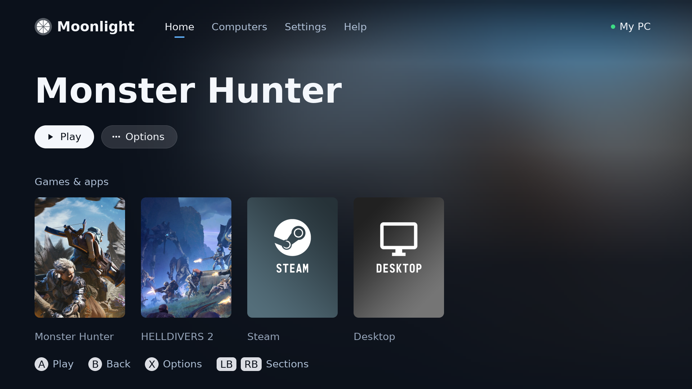
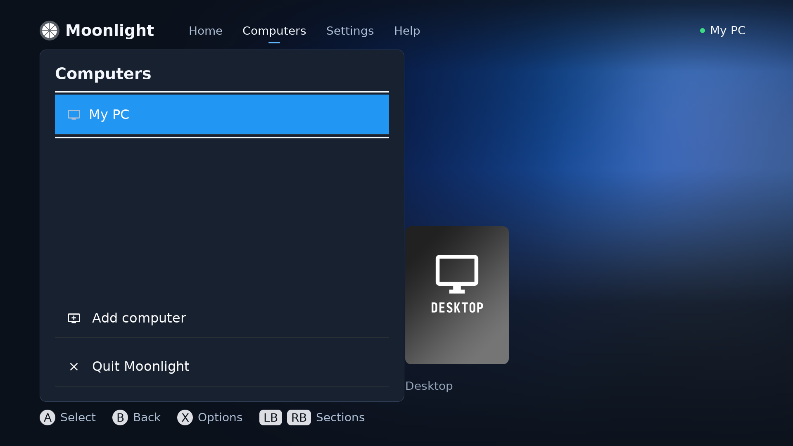
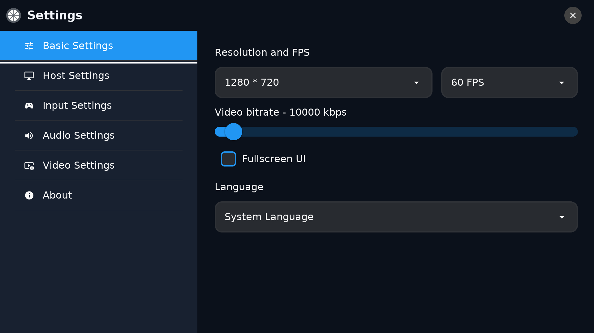
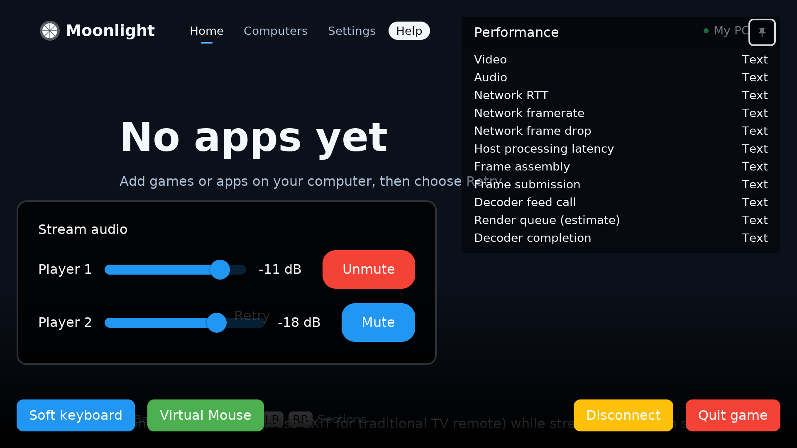

# Moonlight TV — RitzDaCat fork

Patched Moonlight TV client for LG webOS focused on decoder latency experiments,
with a redesigned launcher, stream controls, and experimental two-host split screen.
Forked from [mariotaku/moonlight-tv](https://github.com/mariotaku/moonlight-tv).

## Screenshots

Native previews of the current TV interface, rendered with demo PC/game data.
Game cards and artwork are examples; your paired PC supplies your own library.

**Launcher and game library**



| PC selection | Stream settings |
| --- | --- |
|  |  |

**Stream audio and performance overlay**



The overlay is a layout preview. Its performance values are placeholders, not
measured latency or TV playback results.

## Download and install

Download the ARM `.ipk` from [Releases](https://github.com/RitzDaCat/moonlight-tv/releases).
Install it using [webOS Dev Manager](https://github.com/webosbrew/dev-manager-desktop)
with Developer Mode enabled on your TV, or an already configured webOS CLI:

```sh
ares-install --device tv com.limelight.webos_1.6.45_arm.ipk
```

`tv` is your own CLI device alias. The package uses the upstream app ID
`com.limelight.webos`, so it updates the same application. Back up your existing
configuration before replacing an installed version. Device credentials, pairing
certificates, local configuration, and captured logs are not release assets.

Game cards and artwork come from the apps configured on your own paired Sunshine
host. This fork does not bundle a personal game library, custom game artwork,
host address, or pairing state. On CachyOS/Arch, the optional
[PC setup](host/installer/README.md) configures the current desktop user's PC.
On other systems, install Sunshine using its upstream instructions and pair
your own host normally.

## Decoder latency patches

This release includes the patched `ss4s` decoder library and streaming core.
On the `ndl-webos5` backend, the build requests a native render-drop threshold of
one frame to limit stale frames at the render stage while keeping compressed
reference frames. The request is retried up to eight times per pipeline load;
unsupported firmware keeps its own policy. This trial is enabled in this build.
For a comparison build with the original firmware policy, add
`-DSS4S_NDL_DROP_STALE_FRAMES=OFF` to the webOS build command.

Diagnostics distinguish measured feed-to-completion intervals from a queue-delay
estimate based on queued frames and nominal frame rate. Neither is a direct
input-to-photon measurement. Results depend on the selected decoder backend,
firmware, codec, and stream settings; the NDL change does not modify the SMP backend.
The streaming core also wakes input/control senders on queued work rather than
sleep polling. No universal latency reduction is claimed.

## Other fork changes

- Launcher with a full-width hero, poster shelf, and consistent focus indication.
- Controller navigation fixes for menus, settings, and the streaming overlay.
- Separate **Split screen** page to select games from two paired PCs.
- Independent audio gain and mute controls, saved preferences, and short gain ramps.
- Stream input, statistics, controller touchpad, and sender wake-up changes.
- Sunshine source patches, a CachyOS/Arch host installer, and diagnostic tools in
  [`host/`](host/README.md).

Split screen uses two independent Sunshine hosts; each PC runs its own game and
encoder. Multiplayer synchronization remains the game's responsibility. The
second stream uses a separate copy of the streaming library. Dual-stream decoder
capacity, audio mixing, controller routing, and achievable resolution/frame rate
depend on the TV and require live testing. Dual 4K120 is a target, not a support
claim. Native checks and package builds do not establish TV playback quality or
end-to-end latency. Host experiments have their own limits in the tool documentation.

## Clone

```sh
git clone --recurse-submodules https://github.com/RitzDaCat/moonlight-tv.git
cd moonlight-tv
```

The patched dependencies are public forks pinned by commit:

- [RitzDaCat/moonlight-common-c](https://github.com/RitzDaCat/moonlight-common-c)
- [RitzDaCat/ss4s](https://github.com/RitzDaCat/ss4s)

After updating an existing checkout, run:

```sh
git submodule sync --recursive
git submodule update --init --recursive
```

## Build webOS

Install CMake, a webOS-compatible `ares-package`, and the
[webOS native toolchain](https://github.com/openlgtv/buildroot-nc4).
Run from the repository root, pointing `TOOLCHAIN_FILE` at your installed SDK:

```sh
TOOLCHAIN_FILE=/path/to/sdk/share/buildroot/toolchainfile.cmake \
  ./scripts/webos/easy_build.sh \
  -DCMAKE_BUILD_TYPE=Release -DMOONLIGHT_VERSION_OVERRIDE=1.6.45
```

The package is written to `dist/`. Build files remain under `build/`. The webOS
build enables split screen automatically when linking the static streaming core.
The SDK and external build dependencies are not bundled in this repository.

For Linux development, install the dependencies listed in the
[upstream documentation](https://github.com/mariotaku/moonlight-tv/wiki), then:

```sh
cmake -S . -B build/native-ui -DCMAKE_BUILD_TYPE=Debug \
  -DSS4S_MODULE_BUILD_DUMMY=ON -DMOONLIGHT_VERSION_OVERRIDE=1.6.45
cmake --build build/native-ui --parallel
ctest --test-dir build/native-ui --output-on-failure
```

Native tests cover stream input/audio/statistics, settings, controller navigation,
queue wake-ups, and protocol helpers. They do not exercise the TV hardware decoder.
The desktop build uses a shared core and does not enable the webOS split-screen path.

## Credits and license

Upstream Moonlight TV and its contributors provide the original client and
platform support. [moonlight-embedded](https://github.com/irtimmer/moonlight-embedded)
provided the original libgamestream and decoder components. Dependency licenses
remain in their own repositories. This fork retains the [GPL-3.0 license](LICENSE.txt).
